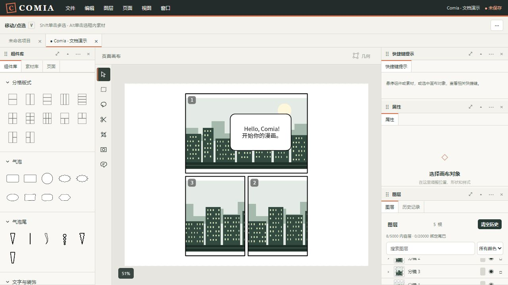

# Comia

**在浏览器里制作漫画、编辑分镜与自由拼贴。**

Comia 将分镜、图片素材、气泡、文字与装饰组织成可独立编辑的图层。你可以从版式开始，也可以自由摆放素材、手绘气泡，再导出单页 PNG 或整部漫画 PDF。编辑和项目保存围绕本地文件进行，无需登录 Comia 账号。

[获取源码：HoshiKurea/Comia](https://github.com/HoshiKurea/Comia) · [全部文档](docs/guide/README.md)



> 图中是当前应用的实际操作截图。灰色分镜序号和编辑辅助线不会出现在导出作品中。演示素材与复现步骤见[功能展示](docs/guide/showcase.md)。

## 从这里开始

| 你想做什么 | 阅读入口 |
| --- | --- |
| 启动应用，完成第一张漫画 | [快速上手](docs/guide/getting-started.md) |
| 查找某个功能的具体操作 | [完整使用手册](docs/guide/user-guide.md) |
| 查看界面、分类和工作流程 | [功能展示](docs/guide/showcase.md) |
| 查快捷键，修改自己的按键 | [快捷键与鼠标操作](docs/guide/shortcuts.md) |
| 排查启动、选择、保存和导出问题 | [常见问题](docs/guide/faq.md) |
| 构建、测试、部署或继续开发 | [开发与部署](docs/guide/development.md) |
| 查看全部文档 | [文档导航](docs/guide/README.md) |

## 能做什么

| 能力 | 当前支持 |
| --- | --- |
| 项目与页面 | 独立漫画项目、多项目标签、多页纸张设置、页面排序、可编辑页面背景 |
| 分镜 | 形状组件、分格版式、行列等分、随机分格、手绘与多边形分格、切割与节点修正 |
| 分镜编号 | 默认日式阅读顺序；普通创建取当前最大号加一；切割连续插号并顺延后续编号 |
| 素材 | 文件导入、拖放与粘贴、文件夹分类、复用原图、自由拼贴、关联与解除分镜关联 |
| 裁剪与遮罩 | 独立工具；裁剪改变实例选择范围，遮罩控制可见区域；均保留素材库原图 |
| 破格 | 整体或局部越过所属分镜边界，保持图层实际前后顺序 |
| 气泡 | 多种情绪轮廓、可修正矢量手绘、边缘抖动、内外描边、独立尾巴、连接／融合／叠加对白 |
| 文字与装饰 | 中英文对白、自动居中文字框、手动换行框、独立文字与声效字、直线速度线笔刷 |
| 选择与图层 | 点选、多选、矩形框选、自由套索、分组、排序、隐藏、锁定与事务撤销重做 |
| 自定义工作区 | 面板左右停靠、浮动、组合、展开；主题、编辑辅助、导出和可编辑快捷键 |
| 自定义组件 | 保存选中组件或组合为预设；气泡和速度线可保存笔刷参数 |
| 文件与输出 | Comia 项目文件、能力允许时的项目目录保存、浏览器本地恢复、PNG、分页 PDF |

**组件**是可编辑的分镜、气泡、文字等；**素材**是用户导入的图片。**新建项目**创建另一部漫画，**新建漫画页**是在当前漫画内增加一页。

## 本地启动

需要 Node.js **22.12.0 或以上**、npm **10 或以上**。依赖版本由 `package-lock.json` 锁定，请使用 `npm ci` 安装。

在项目目录打开 PowerShell：

```powershell
npm ci
npm run dev -- --host 127.0.0.1 --port 5173 --strictPort
```

浏览器打开 [http://127.0.0.1:5173/](http://127.0.0.1:5173/)。如果端口被占用，先查看[启动问题](docs/guide/faq.md#startup)，不要直接结束不明进程。

首次使用：**文件 → 新建项目… → 组件库选择版式 → 素材库导入图片 → 添加气泡 → 保存项目 → 导出**。完整步骤见[第一张漫画](docs/guide/getting-started.md#first-comic)。

## 常用工具

以下为 Windows 默认绑定；如果已经自定义，请以菜单和快捷键提示面板为准。

| 按键 | 工具或操作 |
| --- | --- |
| `V` / `M` / `L` | 移动与点选 / 矩形框选 / 自由套索 |
| `G` / `K` | 分镜几何编辑 / 分镜切割 |
| `C` / `Shift+C` | 素材裁剪 / 素材遮罩 |
| `B` | 手绘气泡笔刷 |
| `Shift+单击` | 追加或取消选中一个对象 |
| `Alt+单击` | 快速选中分镜中的素材 |
| `Ctrl+Z` / `Ctrl+Shift+Z` | 撤销 / 重做 |
| `Ctrl+S` / `Ctrl+Shift+S` | 保存项目 / 另存为 |

修改入口：**文件 → 首选项… → 快捷键**。[查看全部默认绑定与固定手势](docs/guide/shortcuts.md)。

## 保存与导出

- **保存项目**保留页面、图层、素材、分类和组件预设，可继续编辑；项目文件通常为 `作品名.Comia.json`。
- **PNG**输出当前页面；**PDF**按页面列表顺序输出整部漫画。PDF 页面使用栅格图像，文字不会成为可选择的 PDF 文本。
- **浏览器恢复记录**帮助找回中断编辑，不能替代正式保存。清除站点数据可能删除恢复记录和首选项。
- 不支持原生文件写入的浏览器会下载项目副本；请检查下载文件确实落盘。目录保存取决于浏览器能力。

详细说明：[保存、恢复与版本兼容](docs/guide/user-guide.md#storage) · [导出尺寸与限制](docs/guide/user-guide.md#export)。

## 当前范围

Comia 当前以桌面浏览器的漫画排版、对象编辑和拼贴为主要用途。矩形与套索选择完整对象，尚不提供图片局部像素选择、通用像素绘画、PSD 导入导出、云端协作或 AI 生成分镜。随机分格是可复现的几何布局生成。

原生目录访问、本机字体读取和图片解码会受到浏览器能力限制。Windows 浏览器核验不等于 macOS Safari 实机或实体触笔验收；相关范围见[开发与部署](docs/guide/development.md#verification)。

## 开发与核验

```powershell
npm test
npm run build
npm run preview -- --host 127.0.0.1 --port 4173 --strictPort
```

构建会检查打包字体、执行类型检查、生成前端和离线 Service Worker。生产离线需先完整访问生产站点；开发服务不安装离线缓存。

- [工程结构、测试配置与静态部署](docs/guide/development.md)
- [架构与维护约定](docs/architecture.md)
- [当前项目状态](docs/STATUS.md)
- [专项浏览器测试配置](tests/config/README.md)

公共仓库保留运行、构建、测试和使用文档。内部规划、历史审计、原始报告及一次性诊断工具留在开发机，避免把本地工作记录继续发布；当前操作以使用手册为准。

## 许可

打包的 Noto Sans CJK 字体采用 [SIL Open Font License](public/licenses/noto-cjk-OFL.txt)，版本与校验值见[字体清单](public/fonts/manifest.json)。演示城市素材由本项目文档制作，未使用外部图库图片。

仓库已公开，但当前没有指定项目源码的开源许可证；公开可见性和字体许可不等于项目源码的开源授权。使用自行导入的图片与字体时，请遵守对应权利人的授权。
