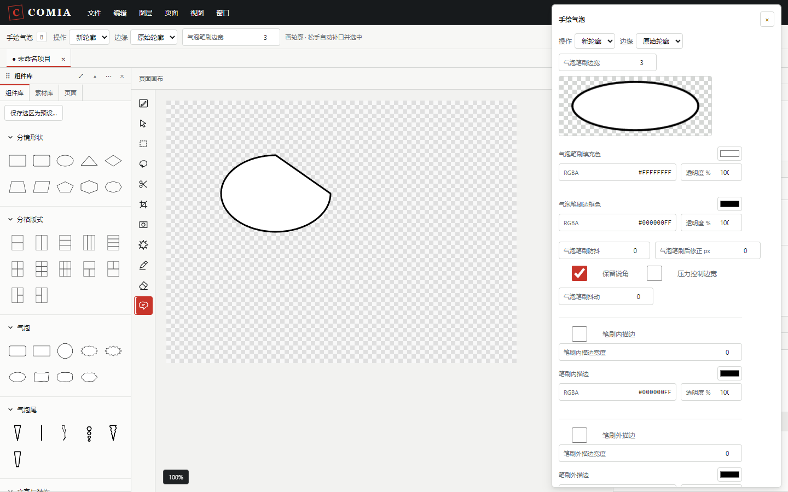
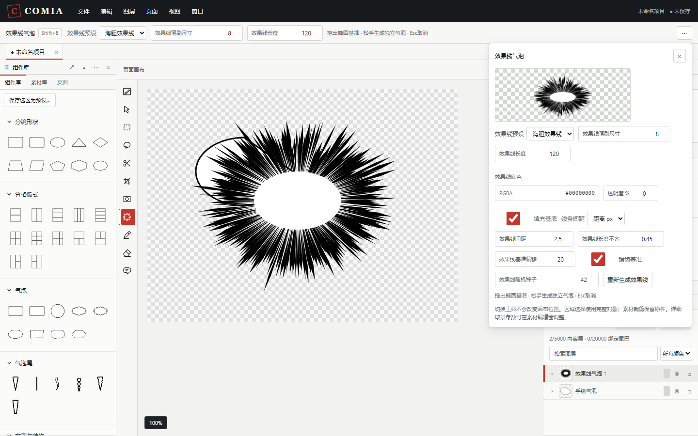

# 气泡画笔、效果线与绘画图层

[返回文档导航](README.md) · [手绘气泡](hand-bubbles.md) · [自由绘画窗口](drawing-window.md)

这些工具直接在主画布工作，笔迹或参数随项目保存。图层可以独立移动、隐藏、锁定、编组、复制和变换；不需要先将整个画面合成图片。

## 气泡画笔

1. 按 **B**，或点击左侧的“手绘气泡”。
2. 在菜单下方固定工具选项栏选择边缘风格与边宽；点击右端 **···** 展开详细设置。
3. 绘制有面积的轮廓。首尾可以留口，松手会连接首尾，生成并选中一个独立气泡。
4. 在属性面板继续修改填充、边框、内外描边、抖动和效果；双击气泡编辑中英文对白。

详细设置提供实际渲染的笔刷预览、填充色、边框色、防抖、后修正、保留锐角、压力边宽和内外描边。颜色既可点色块，也可输入 `#RRGGBB` / `#RRGGBBAA`，并单独编辑透明度。

| 设置 | 实际作用 |
| --- | --- |
| 防抖 0～0.9 | 平滑采样线条；0保留原采样位置 |
| 后修正 0～4屏幕像素 | 减少接近直线的冗余点，按屏幕误差计算；0保留全部平滑后的点 |
| 保留锐角 | 在平滑时保留明显折角，减少尖角被磨圆的情况 |
| 压力控制边宽 | 使用触笔的压力改变轮廓粗细；鼠标仍使用固定粗细 |
| 保存气泡笔刷预设 | 将这些设置保存在当前项目的组件库，供以后启用 |

“画细节／擦细节”编辑气泡上的笔迹；“补画／擦形”改变气泡轮廓。修形改变轮廓后，原轮廓的压力记录会移除，使用属性面板中的统一边宽；细节编辑不会移除它。当前使用圆头笔迹和浏览器抗锯齿，没有复制 CSP 的全部纹理笔尖或四档抗锯齿设置。

## 效果线气泡

按 **Shift+B** 或点击“效果线气泡”，拖出一个椭圆范围，松手生成独立气泡。该范围是线条的基准轮廓，射线可以向范围外延伸；页面之外仍按纸张边界裁剪。按 **V** 返回移动与选择。

支持效果线、反白效果线、密集效果线、海胆效果线和烟火五种预设。展开工具选项设置下一次绘制；选中已有气泡后，在属性面板的“效果线”区域调整这个对象。

| 属性 | 操作效果 |
| --- | --- |
| 笔刷尺寸 | 改变射线粗细 |
| 长度 | 改变向外延伸的长度 |
| 间距：距离 / 角度 | 以椭圆弧长间隔或每条线的角度控制密度 |
| 长度不齐 | 为线条长度增加有界随机变化 |
| 基准偏移 | 调整线条起点偏离基准轮廓的幅度 |
| 锯齿基准 | 让内侧起点产生尖刺变化 |
| 填充基底 | 显示或隐藏中心填充 |
| 底色 | 调整效果线背后的底色；反白预设默认为黑色 |
| 随机种子 / 重新生成 | 改变随机形态；固定种子在保存重开后保持一致 |

主体外观中的“描边色”控制射线颜色，“填充色”控制中心颜色。对白与尾巴沿用现有气泡功能，可以增加文字、调整尾巴、建立连接／融合／叠加对白。射线属于气泡，移动和复制时一起处理；不会产生不可编辑的整幅合成图。

单个效果线最多2048条，超出时会提示增加间距，不会自动减少密度。可用“转为普通气泡”移除射线，保留原主体、对白与尾巴。

## 新建栅格或矢量绘画图层

在 **图层 → 新建图层** 中选择“栅格绘画图层”或“矢量绘画图层”。图层创建后自动选中并进入画笔工具；已有绘画图层也可在图层面板选中，然后按 **P** 绘制、按 **E** 擦除。

| 类型 | 绘制与擦除 | 后续编辑 |
| --- | --- | --- |
| 栅格绘画 | 在固定原始像素画板上绘制，橡皮擦只影响本层像素 | 移动、旋转、缩放、整体透明度与图层效果；缩放保留原始像素尺寸 |
| 矢量绘画 | 保留可缩放的线条，橡皮擦删除碰到的整条线 | 选择线条后修改颜色、粗细、节点序号和局部X/Y坐标，或删除单条线 |

工具选项可修改笔刷尺寸、不透明度、颜色、防抖和触笔压力。橡皮擦不使用画笔颜色；矢量整线擦除也不使用不透明度。每一笔松手产生一次历史记录；拖动期间不会逐帧进入历史。**Esc** 取消尚未松开的这一笔；**Ctrl+Z** 撤销上一笔。选中隐藏或锁定的图层、所属组时会拒绝绘制。

这些是独立绘画图层，不会自动绑定分镜。它们可以放在透明分镜的下方，作为分镜背景或装饰；也可以与分镜编组后一起移动。当前的普通素材绑定与遮罩操作仍针对导入图片，矩形／套索仍选择完整对象。

绘画图层初始化为当前页的像素尺寸，最长边支持8192像素，每层最多256笔／65536个采样点，每笔最多8192点。到达预算会明确取消这一笔并提示，不会删除旧笔迹。栅格画板外的笔迹不会显示，橡皮擦也不会擦到其他图层。

## 纯色、渐变与网点背景

同一“新建图层”菜单还提供三个可编辑背景：

- **纯色背景图层**：修改主色与透明度。
- **渐变背景图层**：修改两个端点颜色和方向角度。
- **网点图层**：修改主色、底色、角度、每英寸线数（LPI）和浓度。

背景默认放在页面纸张之上、内容之下。如果当前选中另一个背景，新背景插在其上方，便于看到结果。可在图层面板调整顺序、编组或自由变换。

网点原始周期为 `图层DPI ÷ LPI` 像素。0%浓度只显示底色，100%为全主色；中间值形成规则圆点，高浓度使用主色中的反向孔洞。网点参数可继续编辑，无需重新导入图片。

## 保存、导出与快捷键

这些能力使用项目格式14；旧项目会迁移，迁移不修改原有页面尺寸、定位线或旧笔迹。保存的新文件需要支持格式14的 Comia 版本。

PNG、PDF、缩略图和画布使用同一内容渲染入口。PNG保留透明像素，PDF沿用白色纸底输出。绘画和效果线会输出，选框、分镜序号、定位线与笔刷预览不会输出。原有导出内存预算保持不变；超预算时请自行选择较低倍率或较低页面DPI。

**B、Shift+B、P、E** 都可在 **文件 → 首选项 → 快捷键** 修改，已有自定义组合继续保留；与新增默认键冲突时优先保留旧命令，并提示为新工具改键。快捷键参考面板会显示所选绘画图层和气泡对应的操作。

## 参考资料与实现边界

气泡笔刷的边色、填色、压力和后修正参考 [CSP 官方气泡教程](https://tips.clip-studio.com/en-us/articles/863)。可编辑效果线的范围、密度与长度参考 [CSP 速度线与集中线说明](https://help.clip-studio.com/en-us/manual_en/540_comic/Speed_lines_and_Focus_lines.htm)。

绘画图层分工参考 [CSP 图层类型](https://help.clip-studio.com/en-us/manual_en/180_layers/What_are_layers__63_.htm)，网点参数参考 [CSP 网点说明](https://help.clip-studio.com/en-us/manual_en/540_comic/Screentones.htm)。Comia 将效果线与气泡文字、尾巴合在自身的对象模型中；并未实现 CSP 的3D、动画、CMYK印前或全套纹理笔刷引擎。
