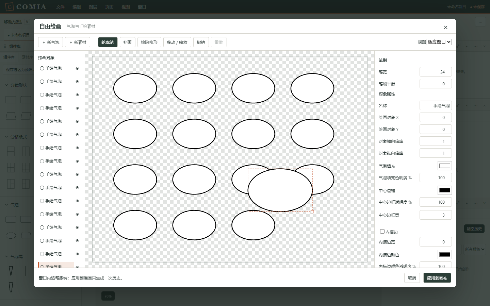

# 自由绘画窗口

[文档导航](README.md) · [使用手册](user-guide.md) · [快捷键](shortcuts.md)

绘画窗口用于直接创作气泡和手绘素材。画好后可以再次打开继续补画、擦除或调整属性，创建过程无需拖动轮廓节点。

## 打开与创建

1. 点击画布左侧工具栏的 **自由绘画窗口** 图标，或选择 **编辑 → 自由绘画窗口…**。
2. 点击 **新气泡** 或 **新素材**。对象列表中会出现当前对象，后续笔画属于它。
3. 画完一个对象后，再点击创建按钮绘制下一个；也可从左侧列表切换对象。
4. 点击 **应用到画布**，所有有效对象分别成为独立图层，并默认选中。多个对象保留在画板中的相对布局，整体放在漫画页面中央。

窗口打开本身不会生成漫画图层。取消有内容的窗口时，可选择继续绘画或放弃草稿；放弃后漫画不改变。空对象不生成占位图层，全部为空时应用会提示先绘制内容。

入口默认未绑定快捷键，可在 **文件 → 首选项 → 快捷键** 中搜索“自由绘画窗口”自行设置。原有 `B` 气泡笔刷仍保留原操作方式。

## 手绘气泡

- **轮廓笔**：画出主体边缘，回到起点附近闭合。轮廓不受原有32节点拟合限制。
- **未闭合的轮廓**：点击“闭合轮廓（预览）”查看连接段，再确认闭合；也可重新绘制。交叉或退化的轮廓会明确提示。
- **补画**：沿边缘刷出凸起或扩大主体。
- **擦除修形**：削去主体边缘。产生孔、分离块或完全擦除时，草稿保留；补画修复或撤销后再应用。气泡主体要求一块闭合且无孔的区域。
- **属性**：填充、中心边框、内描边、外描边及其颜色、透明度、宽度，另有可关闭的边缘抖动。

笔宽控制修形刷的范围；气泡线条粗细使用“中心边框宽”等属性单独调整。气泡的白色填充可改色，也可将填充透明度设为0。

应用后，气泡继续使用主画布的对白、自动居中、尾巴、连接／融合／叠加和组件预设功能。选中由绘画窗口创建的气泡，在属性面板或右键菜单选择 **在绘画窗口编辑**，即可用笔刷继续修形。

## 手绘素材

使用 **画笔** 多笔绘制，修改笔刷颜色、宽度、平滑和透明度；使用 **橡皮** 擦除。画板为透明底，棋盘格只帮助识别透明区域，不会导出。

新素材应用后同时进入素材库和漫画画布，可反复放置。素材保留透明PNG显示图及原笔迹，保存项目后仍能重开绘画窗口。

选中一个手绘素材实例，选择 **在绘画窗口编辑**。应用修改只替换该实例的绘画资源，其他实例及素材库原件保持原样；已有裁剪、遮罩和分镜关联继续保留。导入的照片或背景图片在首版中使用既有裁剪、遮罩等工具，本窗口用于创建新素材。

## 移动、缩放和历史

选择 **移动／缩放** 后，在当前对象的操作框内拖动移动，拖动右下角手柄缩放；属性中也可直接编辑位置及横纵倍率。对象列表可改名、隐藏或删除新建对象。重开窗口仅编辑该目标，不在同一会话中插入新对象。

窗口内的撤销、重做只处理本次绘画；`Ctrl+Z` 和 `Ctrl+Shift+Z` 在普通控件焦点下对应局部撤销、重做。输入框仍保留自己的文字输入操作。

每笔绘画或一次属性确认产生一个局部历史。**应用到画布** 才向漫画增加一次历史，主画布一次撤销即可恢复整批应用前的作品。重开后不做改动直接应用，不增加历史。

失焦或指针中断会取消尚未完成的一笔，已完成的绘画继续保留。漫画或目标在准备应用期间发生变化时，旧草稿不能写入新状态，窗口会提示处理方式。

## 限制与排查

- 新画板默认1024×768；创建对象前可修改，每边16～4096像素。
- 一个窗口最多16个对象。单笔最多8192点，每个对象最多65536点及256次绘画操作。
- 缓冲区按像素估算限制在256MiB；达到限制会提示减少对象或尺寸，不静默缩图。该估算不等于浏览器实际进程内存。
- 气泡出现交叉、孔或分离块时先修形；任意线段、多色涂鸦使用素材模式。
- 导出PNG/PDF是成品；保留 **Comia项目文件** 才能继续修改原笔迹。

画板、对象和资源限制是首版暂定策略；当前实际验证范围见[项目状态](../STATUS.md)。
