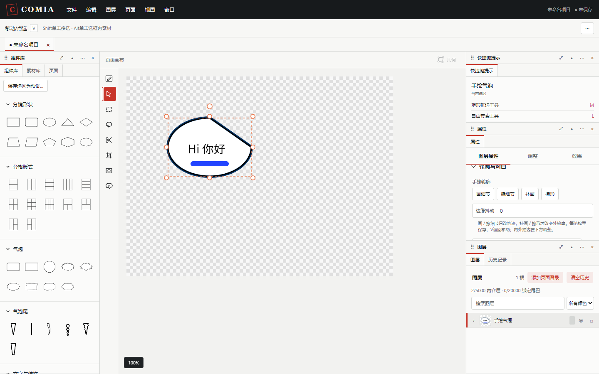

# 主画布手绘气泡

[文档导航](README.md) · [气泡与文字](user-guide.md#bubbles) · [素材绘画窗口](drawing-window.md)

## 画轮廓，松手生成

1. 按 `B`，或选择左侧 **手绘气泡** 工具。
2. 在顶部选项栏选择线条风格及边框宽度；“更多”可设填充、内外描边和边缘抖动。
3. 在页面内按住画出一条轮廓线。可以不闭合，松手后系统直接连接首尾。
4. 合法轮廓立即成为独立气泡并选中，工具返回移动模式；无需再点击完成。

原始轮廓保留，不限制为32个节点。自动连接段也参与自交检测。退化、交叉或过于复杂的轮廓会提示并取消整笔，不留下空图层。关闭边缘抖动可看到基础轮廓。普通几何／节点气泡保留原编辑方式，不会被静默转换。

## 继续画、擦和修形

选中手绘气泡，从属性面板选择：

| 操作 | 效果 |
| --- | --- |
| 画细节 | 添加彩色笔迹，笔迹随气泡移动和变换，可画到主体之外 |
| 擦细节 | 擦掉细节笔迹，不擦穿气泡填充、边框或对白 |
| 补画 | 扩大主体、沿边缘刷出凸起 |
| 擦形 | 削掉轮廓边缘；产生孔、分离块或完全删除主体时整笔拒绝 |

顶部选项栏调整笔宽、颜色和透明度；也可切换四种操作。按 `V`回到移动，`Esc`取消当前未完成笔迹。每次松手提交一次历史，撤销／重做可以恢复整笔。修形时尾巴连接点贴合新边缘，手动摆放的对白保留位置。

**笔宽**控制画擦范围，**边框宽度**控制气泡轮廓粗细，两者独立。气泡仍支持居中中英文对白、尾巴、连接／融合／叠加、复制及组件预设。

## 颜色与描边

填充、边框、内描边、外描边都提供颜色块、RGBA和可输入的透明度百分比。点击颜色块打开颜色选择器；输入 `#RRGGBB` 保留当前透明度，输入 `#RRGGBBAA`同时设置透明度，按 Enter 或移出焦点确认。Esc放弃该输入。

内外描边分别有开关与宽度，默认宽度为0，需要启用并设置正宽度才看得到。填充透明度设为0可以只保留边线。正常属性修改立即生效；如果正在编辑轮廓草稿，颜色进入同一草稿，随“完成／取消漫画组件编辑”确认或放弃。

## 保存与兼容

项目保存基础轮廓、修形和细节源；格式10的旧手绘气泡会升级，保留原绘画内容。自由绘画窗口现在只创作素材，旧气泡从主画布的属性按钮继续编辑。

PNG／PDF按实际输出倍率绘制细节，不包含选中框、工具线、分镜序号或透明棋盘格。保存Comia项目才能继续编辑。

当前每个气泡最多8192轮廓点、65536总点和256笔细节／修形；作者坐标基准每边16～4096，气泡显示尺寸仍遵循对象尺寸限制。首尾连接和单块无孔策略为本次采用的首版范围。
