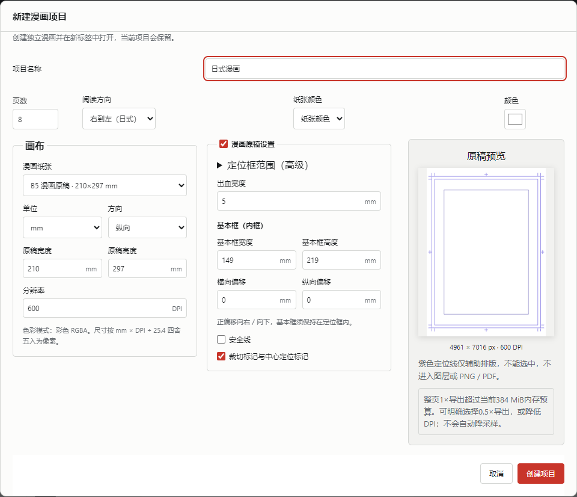
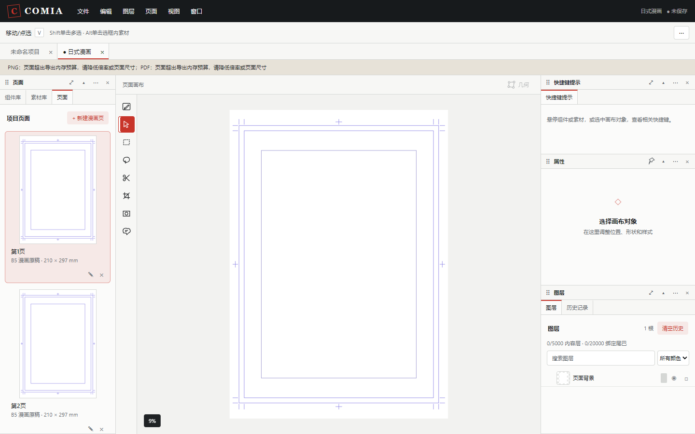

# 漫画原稿与定位线

[文档导航](README.md) · [项目与页面](user-guide.md#projects) · [导出](user-guide.md#export)

**文件 → 新建项目…**默认选择B5漫画原稿（原稿210×297mm），单位mm，使用漫画原稿设置，预览随参数变化。创建后，各页和页面背景都是独立对象；定位线是编辑辅助，不会生成分镜或其他画面元素。



| 参数 | 默认值 |
| --- | --- |
| 漫画纸张 | B5 漫画原稿，原稿画布210 × 297 mm，纵向 |
| 分辨率 | 600 DPI |
| 色彩 | 彩色 RGBA，白色纸张 |
| 定位框范围（高级，默认折叠） | 182 × 257 mm |
| 出血 | 四周各 5 mm |
| 基本框／内框 | 149 × 219 mm |
| 基本框横向／纵向偏移 | 0 mm / 0 mm |
| 安全线 | 默认关闭；开启时默认向定位框内缩 5 mm |
| 裁切及中心定位标记 | 开启 |
| 新项目页数 | 8 页，可改为 1～100 页 |
| 阅读方向 | 右到左（日式），可改为左到右 |

默认选择B5漫画原稿（原稿210×297mm）；还可选择普通A4/A5、JIS B4/B5和ISO B4/B5画布。界面不提供单独的装订／成品信息区。JIS 与 ISO 的 B 系列尺寸不同。自定义画布支持 mm 和 px。定位、出血、基本框和偏移始终以 mm 编辑。像素画布的每边范围为16～16384 px，DPI为72～600的整数。

## 定位线如何使用



- **定位框**：内部定位边界，居中于原稿；相关数值放在默认折叠的高级定位设置中。
- **出血框**：从定位框向四周扩展出血宽度。需要满版的画面通常延伸到这里。
- **基本框**：排版参考范围，可以设置横向和纵向偏移；正值向右／向下。
- **安全线**：可选的定位框内缩参考线，与基本框独立。
- **裁切标记与中心定位标记**：在原稿留白处显示短直线。留白不足时缩短或省略超出纸张的部分。

定位线不能选中、移动、编组或锁定，不会拦截鼠标点击。主画面缩放或平移时，定位线一起跟随，线宽保持屏幕上的细线效果。页面缩略图也叠加定位线，缩略图的画面缓存保持纯画面。

在 **视图 → 显示漫画定位线** 隐藏或显示全部定位线；也可在 **文件 → 首选项… → 编辑辅助**调整，并为菜单命令绑定自己的快捷键。显示开关只保存在此浏览器，不进入漫画的撤销记录，不影响成品输出。

## 修改当前页和增加页面

打开 **页面 → 页面设置…**，在页面面板点击 **漫画原稿与定位线设置…**。修改参数后点击 **应用原稿设置**：尺寸和定位参数作为一次编辑提交，支持完整撤销重做。取消不会更改当前漫画。

更改纸张边界不会缩放或移动已有图层。需要小尺寸自由拼贴页面时，可关闭 **漫画原稿设置** 后使用自定义画布。启用时，定位框加两侧出血必须放进画布；基本框含偏移必须放进定位框；安全框必须保持正宽高。非法参数会显示原因，并禁止提交。

**新建漫画页**一次增加一页，继承当前活动页的像素尺寸、DPI、原稿定位参数和纸张颜色。每页的参数独立，修改一页不会改写其他页。

首次打开应用时的空白工作区是一页漫画原稿；通过新建项目对话框创建一部漫画时才使用8页默认值。旧漫画打开时保留原来的尺寸、DPI和画面，不会自动增加定位线。要给旧页增加定位线，请在原稿设置中启用并选择适合该页的参数。

## 保存和导出

原稿参数随Comia项目保存，当前项目格式为13；支持校验并升级1～12的旧格式。显示开关属于浏览器首选项。PNG和PDF均只绘制正式图层，**不会包含任何定位线、裁切标记或中心定位标记**，也不会自动按定位框裁切：仍输出完整画布。

600 DPI的B5漫画原稿画布为4961 × 7016 px。当前输出仍遵守每边8192px、4000万像素、384 MiB估算内存预算；这张原稿的整页1×输出超过内存预检预算，因此新建预览及导出菜单会明确提示。可由你选择0.5×输出（2481 × 3508 px）、0.25×输出，或在创建前选择较低DPI；系统不会自动降低倍率。PDF物理纸张尺寸不随倍率改变。含大量图片或效果时，较低倍率也须通过实际资源预算检查。

## 换算与精度

```text
k = DPI / 25.4                 // 每毫米对应的像素
canvasPx = round(canvasMm * k) // 仅画布尺寸四舍五入
trimX = (canvasWidthPx - trimWidthMm * k) / 2
trimY = (canvasHeightPx - trimHeightMm * k) / 2
bleedRect = expand(trimRect, bleedMm * k)
basicX = (canvasWidthPx - basicWidthMm * k) / 2 + offsetXMm * k
basicY = (canvasHeightPx - basicHeightMm * k) / 2 + offsetYMm * k
screenPoint = pagePoint * zoom + pan
```

定位几何不逐边取整，因此基本框和定位框始终对称；只有显示栅格会抗锯齿。画布保存像素尺寸，重新打开自定义毫米输入时，可能显示像素反算后的微小小数差；不会改变内容位置。

本次实现的是原稿、页数和定位参考。封面、作品信息、拼合裁切及印刷页码并未因此添加为画面元素。
