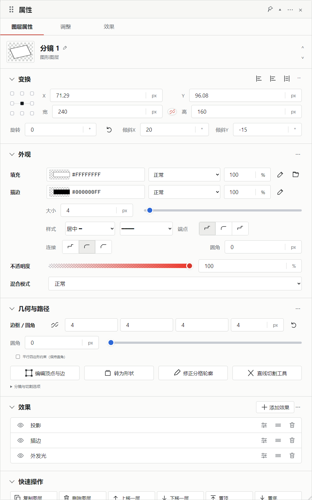
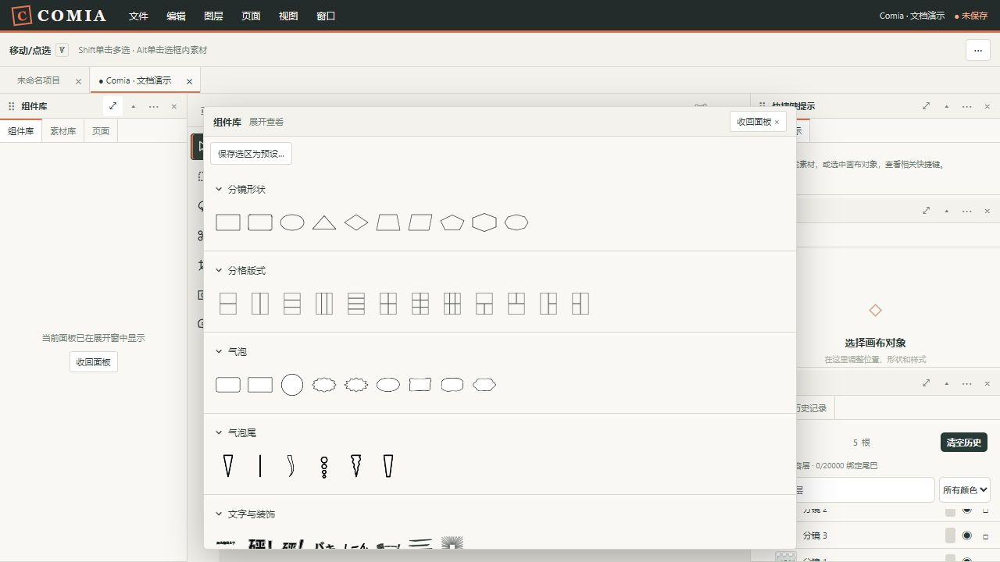
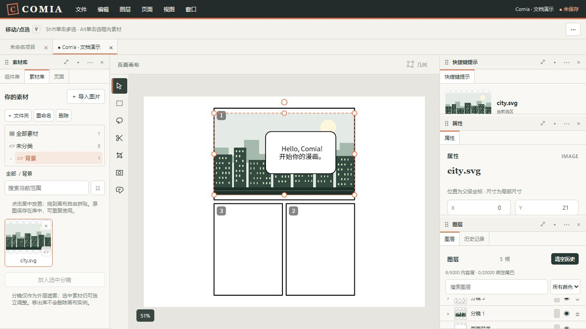
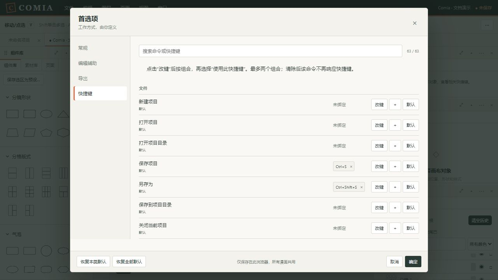

# 功能展示

[文档导航](README.md) · [快速上手](getting-started.md) · [完整使用手册](user-guide.md)

旧作品演示截图于 **2026-10-11**获取，视口为 **1280 × 720**；手绘截图于 **2026-10-12**获取，视口为 **1440 × 900**；完整属性浮窗于 **2026-10-13**获取，视口为 **1500 × 1850**。均来自实际应用和独立测试作品，没有修改用户正在编辑的漫画。城市背景由文档专用 SVG 制作。

## 属性面板

2026-10-13的实际Edge、1004px宽浮窗。控件按变换、外观、几何与路径、效果和快速操作排序；九点基准、比例锁、双向倾斜、四边描边、混合、取色、预设及图层效果已接通。默认停靠时保留相同分组并使用紧凑布局。[具体操作](properties.md)。

## 主画布手绘气泡

在主画布画一条开口轮廓，松手直接生成气泡；继续画／擦细节和修形，描边可独立改色。[操作步骤](hand-bubbles.md)。

## 自由绘画窗口

2026-10-12的实际Edge、1440×900视口截图。窗口只创作素材，支持多色画笔、橡皮、对象移动／缩放及重新编辑；[操作步骤](drawing-window.md)。图中16个对象用于连续输入核验，性能结果见[当前状态](../STATUS.md)。

## 编辑一张三分镜漫画

图中使用“上大下二”版式。上方分镜为 1，下方右侧为 2、左侧为 3；每个框可独立编辑。相同素材原图放置三次形成独立实例，气泡使用中英文两行对白。

顶部依次为菜单、固定工具选项栏和漫画项目标签；画布旁提供工具入口。组件与素材在左侧，快捷键提示、属性和图层默认在右侧，均可重新停靠和组合。

**灰色序号是编辑标识，不属于画面。**成品不包含序号、工具栏或面板。

## 图标分类组件库

普通组件只显示图标，按类别折叠。悬停时可查看对应组件与可用操作；点击直接放置，拖放则有跟随鼠标的半透明预览。

展开窗适合查看大量选项，不需要让整个侧边栏产生长滚动条。自定义组件和分格工具在后续分类中，内部仍可继续滚动。

## 素材文件夹与框内图片

这个截图记录制作过程中的第一张素材实例：库原图归在“背景”文件夹，画布上已放入分镜 1。后续同图复用于其他两格。

选中图片后可以编辑它自己的属性；分镜关联仅提供外部裁剪，不让素材变成不可编辑的固定背景。自由编辑、裁剪、遮罩和破格的差别见[素材工作流](user-guide.md#crop-mask)。

## 全局首选项与快捷键

“文件 → 首选项…”集中管理主题、编辑辅助、默认输出倍率和快捷键。已有默认组合、没有绑定的命令和自定义组合在同一界面管理；改键冲突会提示，取消不会修改现有设置。

## 自己复现

按[快速上手](getting-started.md#first-comic)创建 **1200 × 900 px、300 DPI**的白底漫画：

1. 添加“上大下二”版式。
2. 新建素材文件夹“背景”，导入[city.svg](../examples/city.svg)。
3. 分别选择三个分镜，用“放入选中分镜”复用原图。
4. 添加“对白气泡”，移动到上方分镜，输入 `Hello, Comia!` 与 `开始你的漫画。`两行文字。
5. 正式保存自己的项目，再输出 PNG。

本组示例提供可导入素材与实际截图，未附已保存的漫画源文件或 PDF 成品。截图不是导出文件，也不作为跨浏览器、性能或系统选择器验收证据。
